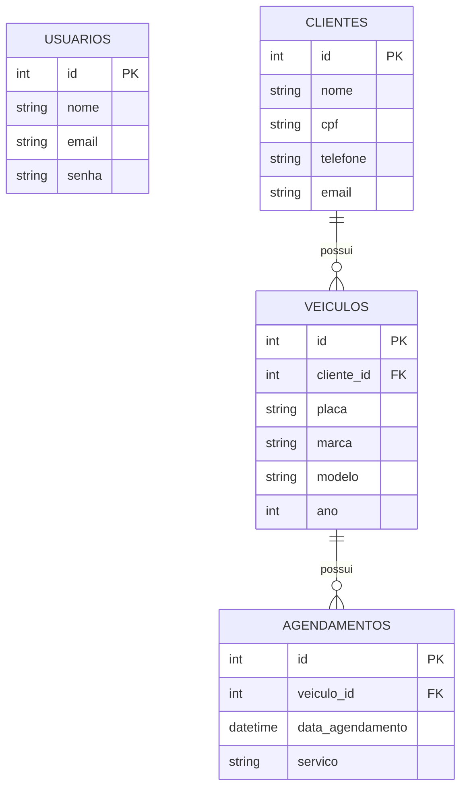

# Roteiro de Live Coding - Sistema da Oficina Mecânica (Torque)

> Material do professor. Duração estimada: **4 h 30** com pausas (ajuste os blocos conforme a turma).
> Estratégia: construir o `app.js` (back) e a pasta `paginas/` (front, arquivos `.html`) **do zero, em camadas**, testando no navegador a cada etapa.
> Cada etapa termina com algo que **funciona e pode ser mostrado**, e com um **checkpoint** que o aluno confere no próprio computador.

> 🎯 **Por que este roteiro é detalhado:** na avaliação, os alunos construirão um sistema **semelhante** (outro tema, mesma arquitetura). Por isso a live ensina a **receita**, não só este projeto. O Anexo C resume a receita em passos reutilizáveis.

## Como usar este roteiro

| Símbolo / bloco | Significado |
|---|---|
| **Fala:** | Sugestão do que dizer à turma ao abrir a etapa |
| **Pontos para discutir** | Perguntas e explicações para fazer *enquanto* o código aparece na tela |
| **Teste ao vivo** | O que executar no navegador/MySQL para provar que funcionou |
| **Checkpoint** | O estado em que o projeto deve estar ao fim da etapa; se o aluno não chegou lá, não avance |
| ⚠️ | Armadilha ou erro comum |
| 🕵️ | Desafio para a turma encontrar o erro |
| ✅ | Regra de negócio entregue (marque na tabela da seção 1) |

**Ritmo sugerido para cada etapa:** (1) diga o objetivo em uma frase, (2) escreva o código **digitando**, não colando, (3) rode e mostre funcionando, (4) faça uma pergunta de fixação, (5) só então avance.

**Sobre os comentários:** os trechos deste roteiro trazem comentários para você explicar o código. O `app.js` do repositório **não tem comentários** (versão limpa, para os alunos compararem com o que foi construído na live). Os arquivos de `paginas/` do repositório trazem alguns comentários em HTML.

---

## 0. Objetivos de aprendizagem

Ao final, o aluno será capaz de:

1. Transformar um enunciado em **requisitos funcionais, regras de negócio e DER**.
2. Criar o banco MySQL com chaves primárias/estrangeiras e carga inicial.
3. Distinguir **hash** (senha, irreversível) de **criptografia** (CPF, reversível) e aplicar a LGPD.
4. Implementar autenticação com **JWT com expiração** e proteger rotas com middleware.
5. Fazer CRUD com Express + MySQL usando **consultas parametrizadas** (evitar SQL Injection) e **escape de HTML** (evitar XSS).
6. Usar `JOIN`, `LIKE` e `ORDER BY` em consultas reais.
7. Separar **back** (regras, banco) de **front** (HTML com marcadores) e usar os **verbos HTTP** corretamente.

## 1. Mapa: enunciado → regra → onde implementar

| Regra do enunciado | Código | Onde |
|---|---|---|
| RN01 – 3 registros por tabela | `INSERT` com 3 linhas | `database/script.sql` (gerado por `gerar-script.js`) |
| RN02 – falha de login com mensagem | `mostrar('login', { erro })` | `POST /login` + `login.html` |
| RN10 – token com expiração | `jwt.sign(..., { expiresIn: '1h' })` + `jwt.verify` no middleware | `POST /login`, `app.use(...)` |
| RN03 – CPF criptografado | `criptografar()` / `descriptografar()` | funções de apoio + `/clientes` |
| RN04 – nome do usuário, links, sair | `principal.html` + `POST /sair` | `GET /principal` |
| RN05 – busca de clientes | `WHERE nome LIKE ?` | `GET /clientes` + formulário GET |
| RN06 – editar cliente | `UPDATE clientes ...` | `PUT /clientes/:id` + `?editar=ID` |
| RN07 – agendamentos ordenados c/ cliente e veículo | `JOIN` + `ORDER BY` | `GET /agendamentos` |
| RN08 – alterar data do agendamento | `UPDATE agendamentos SET data_agendamento` | `PUT /agendamentos/:id` |
| RN09 – veículo associado a cliente | `cliente_id NOT NULL` + `<select>` + validação | `/veiculos` |

> 💡 Deixe esta tabela projetada/aberta durante a aula e marque ✅ conforme cada regra for entregue.

## 2. Arquivos do projeto final

```
torque/
├── app.js                  BACK: rotas, regras, login, criptografia e SQL
├── paginas/                FRONT: HTML puro com {{marcadores}}
│   ├── login.html
│   ├── principal.html
│   ├── clientes.html
│   ├── veiculos.html
│   └── agendamentos.html
├── database/script.sql     tabelas + dados (gerado)
├── gerar-script.js         gera o script.sql com CPF criptografado e senha com hash
├── docs/                   este roteiro (requisitos e DER ficam fora do repositório)
├── .env / .env.example     configurações e segredos
├── .gitignore
└── package.json
```

| Arquivo | Papel | Etapa |
|---|---|---|
| `docs/requisitos.md`, `docs/der.md` | Documentação exigida pelo gestor (feita no quadro/editor na etapa 0; **não incluída** neste repositório) | 0 |
| `package.json`, `.env`, `.env.example`, `.gitignore` | Projeto e configuração | 1 |
| `gerar-script.js` → `database/script.sql` | Gerador (foco da etapa 2) e o SQL que ele produz | 2 |
| `app.js` | Back-end (cresce a cada etapa) | 4 a 9 |
| `paginas/*.html` | Front-end (uma página por etapa) | 5 a 9 |
| `.env`, `node_modules/` | Locais, ignorados pelo git | explicar por que não vão ao git |

---

## 3. Preparação do professor (antes da aula)

- [ ] MySQL rodando; usuário/senha conhecidos.
- [ ] Node.js instalado (`node -v`).
- [ ] **Porta 3000 livre.** Um servidor antigo esquecido na porta faz o código novo nunca rodar (sintoma: "Método não permitido"). Verifique com `netstat -ano | findstr :3000` (Windows) e encerre o processo que aparecer.
- [ ] Pasta vazia `oficina-live/` aberta no VS Code, **com a subpasta `database/` já criada** (o gerador não cria a pasta) e a subpasta `paginas/`.
- [ ] Repositório pronto em outra janela como **plano B** (se a live travar, copie a etapa).
- [ ] Navegador com abas: `localhost:3000` e o MySQL Workbench/CLI.
- [ ] Fonte do editor grande (≥ 18 pt).
- [ ] Trechos das etapas prontos em um bloco de notas (snippets).

---

## Etapa 0 – Entender o problema e documentar (20 min)

**Fala:** "Uma oficina controla tudo no papel: perde horários, duplica dados e guarda CPF sem proteção. Nosso trabalho é resolver isso. E antes de programar, a gente documenta."

### 0.1 Ler o enunciado

1. Leia o enunciado (`Contexto da atividade.txt`) **em voz alta** e peça aos alunos que sublinhem **substantivos** (→ tabelas) e **verbos** (→ funcionalidades).
2. Monte no quadro as **entidades**: usuário, cliente, veículo, agendamento.
3. Pergunte: *"Por que `usuarios` não tem relação com as outras tabelas?"* → só serve para login.

### 0.2 Requisitos funcionais (`docs/requisitos.md`)

Cada verbo do enunciado vira um requisito. Exemplo do projeto:

| Código | Requisito |
|---|---|
| RF01 | Permitir login com e-mail e senha |
| RF02 | Informar ao usuário quando o login falhar |
| RF03 | Manter o login válido por tempo limitado (token com expiração) |
| RF04 | Tela principal com nome do usuário, links de navegação e logout |
| RF05 | Buscar clientes pelo nome |
| RF06 | Editar os dados de um cliente |
| RF07 | Armazenar o CPF criptografado |
| RF08 | Cadastrar veículos associados a um cliente existente |
| RF09 | Listar agendamentos ordenados por data, com dados do veículo e do cliente |
| RF10 | Alterar a data de um agendamento |

Inclua também a tabela de **infraestrutura** (SGBD, Node, Express, mysql2 etc.) com as versões usadas.

### 0.3 DER (`docs/der.md`)

Desenhe o DER em Mermaid (e exporte para PDF, se o gestor pedir):



Leitura: *um cliente possui zero ou muitos veículos; um veículo possui zero ou muitos agendamentos.* O agendamento chega ao cliente **através do veículo**.

**Ponto de atenção LGPD:** CPF é dado pessoal; vamos protegê-lo no banco.

**Checkpoint:** quadro com entidades, lista RF01–RF10 e DER prontos.

---

## Etapa 1 – Projeto Node e dependências (15 min)

```bash
mkdir oficina-live && cd oficina-live
npm init -y
npm install express mysql2 bcryptjs jsonwebtoken dotenv cookie-parser mustache
```

| Pacote | Para quê |
|---|---|
| `express` | Servidor web e rotas |
| `mysql2` | Conexão com o MySQL (usamos a versão `/promise`, com `await`) |
| `bcryptjs` | Hash de senha |
| `jsonwebtoken` | Criar e validar o token JWT |
| `dotenv` | Ler o arquivo `.env` |
| `cookie-parser` | Ler cookies (`req.cookies`) |
| `mustache` | Preencher os `{{marcadores}}` dos `.html` |

(`fs`, `path` e `crypto` já vêm com o Node; não se instalam.)

Crie o `.env` (e explique cada variável; mostre o `.env.example` como o "molde" que vai para o git):

```env
DB_HOST=localhost
DB_USER=root
DB_PASSWORD=
DB_NAME=oficina
PORT=3000
JWT_SECRET=segredo-da-oficina
CRIPTO_CHAVE=12345678901234567890123456789012
CRIPTO_IV=1234567890123456
```

No `package.json`, ajuste `main` e os scripts:

```json
"main": "app.js",
"scripts": {
  "start": "node app.js",
  "gerar-script": "node gerar-script.js"
}
```

E crie o `.gitignore`:

```
node_modules/
.env
```

**Perguntas rápidas:**
- Por que o `.env` não vai para o git? (segredos)
- Por que a chave precisa ter **32** caracteres e o IV **16**? (AES-256-CBC → chave de 256 bits = 32 bytes; bloco de 128 bits = 16 bytes)

> ⚠️ Avise: em produção a chave/IV seriam fortes e diferentes. O IV fixo é uma simplificação **didática**.

**Checkpoint:** pasta com `package.json`, `.env`, `.env.example`, `.gitignore` e `node_modules/`.

---

## Etapa 2 – Os dados do banco: o `gerar-script.js` (25 min) → RN01, RN03

> 🎯 **Foco desta etapa:** não vamos modelar nem escrever o SQL ao vivo. O `script.sql` é um **produto** do `gerar-script.js`. O que a turma precisa entender é **por que** existe um gerador e **como** ele funciona, linha por linha.

### 2.1 Por que precisamos de um gerador?

Mostre que **não dá para digitar à mão** dois valores do SQL:

| Valor | Por quê |
|---|---|
| Senha com **hash** (bcrypt) | O hash tem "sal" aleatório e 60 caracteres; ninguém escreve isso de cabeça |
| CPF **criptografado** (AES-256) | Só a chave do `.env` produz o valor certo; com outra chave o `app.js` não consegue descriptografar |

**Fala:** "Se eu digitasse um CPF qualquer no `INSERT`, o `app.js` quebraria ao tentar descriptografar. O gerador usa **a mesma chave do `.env`** que o `app.js` usa; por isso os dois conversam."

### 2.2 Construindo o `gerar-script.js` em 5 blocos

⚠️ **Antes de começar:** crie a pasta `database/` vazia. O `fs.writeFileSync` cria o arquivo, mas **não cria a pasta**; sem ela o gerador falha com `ENOENT`.

**Bloco 1 – Importações e `.env`**

```js
require('dotenv').config();           // 1º: lê o .env (chave e IV do CPF)
const fs = require('fs');             // gravar o arquivo .sql
const path = require('path');         // montar o caminho de forma segura (Windows/Linux)
const bcrypt = require('bcryptjs');   // hash de senha
const crypto = require('crypto');     // criptografia AES (já vem com o Node)
```

- É o **mesmo `.env`** do `app.js`: o gerador e o servidor precisam usar a mesma chave.
- `fs`, `path` e `crypto` são nativos; `bcryptjs` e `dotenv` vieram do `npm install`.

**Bloco 2 – Função que criptografa o CPF**

```js
function criptografarCpf(texto) {
  const cifra = crypto.createCipheriv('aes-256-cbc', process.env.CRIPTO_CHAVE, process.env.CRIPTO_IV);
  return cifra.update(texto, 'utf8', 'hex') + cifra.final('hex');
}
```

- `aes-256-cbc`: algoritmo. **256** = chave de 32 caracteres; o **IV** (16 caracteres) é o ponto de partida do bloco.
- `update(texto, 'utf8', 'hex')`: entra texto comum, sai **hexadecimal**. `final('hex')` fecha o último bloco. Por isso o resultado tem 32 caracteres (e a coluna é `VARCHAR(255)`).
- É a **mesma função** que existe no `app.js` (`criptografar`). Pergunte: *"Por que repetir o código em vez de importar do `app.js`?"* → o gerador roda **sozinho**, sem subir o servidor nem conectar ao banco. (Melhoria: extrair para um módulo `cripto.js` usado pelos dois.)

**Teste ao vivo:** acrescente ao fim do arquivo `console.log(criptografarCpf('11122233344'))` e rode `node gerar-script.js` **duas vezes**:

| | 1ª execução | 2ª execução |
|---|---|---|
| CPF criptografado | `a3f1…` | `a3f1…` (**igual**) |

Agora troque para `console.log(bcrypt.hashSync('123456', 10))` e rode duas vezes: o hash **muda a cada vez** (tem "sal"). Isso abre a discussão da etapa 3. Depois **apague** os `console.log` de teste.

**Bloco 3 – Gerando os valores**

```js
const senhaHash = bcrypt.hashSync('123456', 10);   // uma vez só: os 3 usuários dividem o mesmo hash

const cpf1 = criptografarCpf('11122233344');
const cpf2 = criptografarCpf('22233344455');
const cpf3 = criptografarCpf('33344455566');
```

- `10` = custo (rounds) do bcrypt: quanto maior, mais lento e mais difícil de quebrar por força bruta.
- `hashSync` (versão **síncrona**) é aceitável aqui porque é um script de uma execução só; no `app.js` usamos `bcrypt.compare` com `await`.
- Todos os usuários terão a senha `123456` **só para facilitar os testes**.

**Bloco 4 – O SQL dentro de uma *template string***

A string entre crases (`` ` ``) aceita **várias linhas** e **`${variável}`**. Escreva o início e mostre que o `${senhaHash}` será trocado pelo valor gerado:

```js
const sql = `-- Script gerado automaticamente por gerar-script.js
-- Nao edite o CPF ou a senha a mao: use "npm run gerar-script"

CREATE DATABASE IF NOT EXISTS oficina;
USE oficina;

CREATE TABLE usuarios (
  id INT AUTO_INCREMENT PRIMARY KEY,
  nome VARCHAR(100) NOT NULL,
  email VARCHAR(100) NOT NULL UNIQUE,
  senha VARCHAR(255) NOT NULL
);

CREATE TABLE clientes (
  id INT AUTO_INCREMENT PRIMARY KEY,
  nome VARCHAR(100) NOT NULL,
  cpf VARCHAR(255) NOT NULL,
  telefone VARCHAR(20),
  email VARCHAR(100)
);

CREATE TABLE veiculos (
  id INT AUTO_INCREMENT PRIMARY KEY,
  cliente_id INT NOT NULL,
  placa VARCHAR(10) NOT NULL,
  marca VARCHAR(50),
  modelo VARCHAR(50),
  ano INT,
  FOREIGN KEY (cliente_id) REFERENCES clientes(id)
);

CREATE TABLE agendamentos (
  id INT AUTO_INCREMENT PRIMARY KEY,
  veiculo_id INT NOT NULL,
  data_agendamento DATETIME NOT NULL,
  servico VARCHAR(100),
  FOREIGN KEY (veiculo_id) REFERENCES veiculos(id)
);

-- RN01: pelo menos 3 registros em cada tabela

-- Usuario de teste: admin@oficina.com / 123456
INSERT INTO usuarios (nome, email, senha) VALUES
  ('Administrador', 'admin@oficina.com', '${senhaHash}'),
  ('Carlos Mecanico', 'carlos@oficina.com', '${senhaHash}'),
  ('Fernanda Atendente', 'fernanda@oficina.com', '${senhaHash}');

-- CPF salvo criptografado [RN03]
INSERT INTO clientes (nome, cpf, telefone, email) VALUES
  ('Joao da Silva', '${cpf1}', '(11) 90000-1111', 'joao.silva@email.com'),
  ('Maria Souza', '${cpf2}', '(11) 90000-2222', 'maria.souza@email.com'),
  ('Pedro Oliveira', '${cpf3}', '(11) 90000-3333', 'pedro.oliveira@email.com');

-- Cada veiculo associado a um cliente [RN09]
INSERT INTO veiculos (cliente_id, placa, marca, modelo, ano) VALUES
  (1, 'ABC1D23', 'Volkswagen', 'Gol', 2018),
  (2, 'DEF4E56', 'Fiat', 'Palio', 2015),
  (3, 'GHI7F89', 'Chevrolet', 'Onix', 2021);

-- Datas fora de ordem para provar que a ordenacao funciona [RN07]
INSERT INTO agendamentos (veiculo_id, data_agendamento, servico) VALUES
  (2, '2026-11-05 09:00:00', 'Troca de oleo'),
  (1, '2026-10-20 14:30:00', 'Alinhamento e balanceamento'),
  (3, '2026-10-28 08:00:00', 'Revisao dos freios');
`;
```

> 💬 **Como conduzir:** o SQL das tabelas **não é o foco**; cole o bloco pronto e percorra só o que importa para o gerador. Quem quiser aprofundar o modelo pode consultar o DER da etapa 0.

**O que explicar neste bloco (e só isso):**
- Só **quatro** pontos do SQL dependem do JavaScript: `${senhaHash}` (3×) e `${cpf1}`, `${cpf2}`, `${cpf3}`. **Todo o resto é texto fixo.**
- `cpf VARCHAR(255)`: o valor gravado é o texto **criptografado**, não 11 dígitos.
- Os `cliente_id` e `veiculo_id` dos `INSERT`s (1, 2, 3) **precisam existir**; senão a chave estrangeira recusa. Por isso a ordem: `usuarios` e `clientes` → `veiculos` → `agendamentos`.
- RN01: **3 linhas por tabela**. As datas dos agendamentos estão **fora de ordem de propósito** (prova do `ORDER BY` na etapa 9).
- ⚠️ Os `--` dentro da string são comentários **do SQL**, não do JavaScript; vão parar dentro do arquivo gerado.

**Bloco 5 – Gravando o arquivo**

```js
const caminhoSaida = path.join(__dirname, 'database', 'script.sql');
fs.writeFileSync(caminhoSaida, sql);
console.log(`Arquivo gerado em ${caminhoSaida}`);
```

- `__dirname` = pasta onde está o `gerar-script.js`. Funciona **de qualquer pasta** em que o comando for chamado.
- `path.join` monta o caminho com a barra correta para cada sistema operacional.
- `writeFileSync` **sobrescreve** o arquivo se ele já existir: rodar o gerador de novo é seguro.

### 2.3 Rodar e conferir

```bash
npm run gerar-script
mysql -u root -p < database/script.sql
```

Abra o `database/script.sql` gerado e mostre que o `${senhaHash}` virou um texto como `$2a$10$...` e os CPFs viraram hexadecimais. Depois, no MySQL:

```sql
USE oficina;
SELECT id, nome, cpf FROM clientes;    -- CPF ilegível = RN03 ✅
SELECT COUNT(*) FROM agendamentos;     -- 3 = RN01 ✅
```

**Perguntas de fixação**
- *"Se eu mudar o `CRIPTO_CHAVE` no `.env` depois de carregar o banco, o que acontece na tela de clientes?"* → erro ao descriptografar; é preciso **regerar o script e recarregar o banco**.
- *"Por que o hash da senha muda a cada execução e o CPF não?"* → o bcrypt usa um sal aleatório; no AES, a mesma chave + mesmo IV + mesmo texto = mesma saída (é a limitação do IV fixo; veja a seção 11).
- *"Posso editar o `script.sql` à mão?"* → não: ele é **gerado**; a fonte da verdade é o `gerar-script.js`.

⚠️ Se rodar o `script.sql` de novo, o `CREATE TABLE` falha porque as tabelas já existem. Para recarregar, apague antes: `DROP DATABASE oficina;`.

**Checkpoint:** `gerar-script.js` completo, `database/script.sql` gerado e carregado (4 tabelas, 3 linhas em cada).

---

## Etapa 3 – Hash × Criptografia (10 min, conceito)

Desenhe no quadro:

| | Senha | CPF |
|---|---|---|
| Técnica | **Hash** (bcrypt) | **Criptografia** (AES-256-CBC) |
| Reversível? | ❌ Nunca | ✅ Com a chave |
| Por quê? | Só precisamos *comparar* | Precisamos *exibir* o CPF de volta |
| Código | `bcrypt.compare(senha, hash)` | `descriptografar(valor)` |

**Pergunta de fixação:** *"Se o gestor pedisse para mostrar a senha do usuário na tela, daria? E o CPF?"*

---

## Etapa 4 – Back e front separados (35 min)

### 4.1 A ideia: duas responsabilidades

Desenhe no quadro:

```
navegador --pedido--> app.js (BACK) --dados--> paginas/*.html (FRONT) --> navegador
                      rotas, regras,           HTML puro com
                      login, SQL, CPF          {{marcadores}}
```

| Onde | Responsabilidade | Exemplo |
|---|---|---|
| `app.js` (back) | Receber pedidos, validar, falar com o banco | `SELECT`, `bcrypt`, `jwt`, `criptografar` |
| `paginas/*.html` (front) | Mostrar os dados | `<table>`, `<form>`, `{{nome}}` |

**Regra de ouro para a turma:** *"Se tem SQL, senha, token ou criptografia, é `app.js`. Se tem `<tag>`, é um arquivo `.html`."*

### 4.2 Como o HTML recebe os dados: `{{marcadores}}`

O `.html` é HTML comum, com "buracos" no formato `{{nome}}`. O back preenche os buracos antes de enviar ao navegador.

```html
<!-- paginas/principal.html -->
<h1>Ola, {{nome}}</h1>
```

```js
mostrar('principal', { nome: 'Maria' })   // → <h1>Ola, Maria</h1>
```

Os quatro recursos que vamos usar (biblioteca **mustache**):

| Sintaxe | O que faz |
|---|---|
| `{{nome}}` | Escreve o valor, **já protegendo contra XSS** (`<` vira `&lt;`) |
| `{{#clientes}} ... {{/clientes}}` | **Repete** o trecho para cada item da lista (ou mostra se for `true`) |
| `{{^editando}} ... {{/editando}}` | Mostra o trecho só se for `false`/vazio |
| `{{form.nome}}` | Entra no objeto `form` e pega o campo `nome` |

> 💬 Decisão didática: não há CSS nem JavaScript no navegador. O servidor devolve a página pronta.

**Demonstração do XSS (mais tarde):** cadastre um cliente com nome `<script>alert(1)</script>` e mostre que aparece como texto na tela. O `{{ }}` faz o escape sozinho.

### 4.3 Começando o `app.js` (back)

```js
require('dotenv').config();                 // 1º: carrega o .env antes de tudo
const fs = require('fs');
const path = require('path');
const express = require('express');
const mysql = require('mysql2/promise');
const bcrypt = require('bcryptjs');
const jwt = require('jsonwebtoken');
const crypto = require('crypto');
const cookieParser = require('cookie-parser');
const Mustache = require('mustache');

const app = express();
app.use(express.urlencoded({ extended: false })); // lê os dados dos formulários (req.body)
app.use(cookieParser());                          // lê os cookies (req.cookies)

const db = mysql.createPool({
  host: process.env.DB_HOST,
  user: process.env.DB_USER,
  password: process.env.DB_PASSWORD,
  database: process.env.DB_NAME,
  dateStrings: true,   // datas chegam como texto, sem conversão de fuso
});

const porta = process.env.PORT || 3000;
app.listen(porta, () => console.log(`Oficina rodando em http://localhost:${porta}`));
```

Rode `npm start`. O servidor sobe (ainda sem rotas; o navegador mostra "Cannot GET /").

**Explicando o esqueleto, linha a linha** (percorra apontando com o cursor):

| Trecho | O que explicar |
|---|---|
| `require('dotenv').config()` | Lê o `.env` e coloca cada linha em `process.env`. Tem que ser a **primeira** linha: qualquer `process.env.X` antes dela seria `undefined` |
| `const fs`, `path`, `crypto` | Módulos **nativos** do Node (não precisam de `npm install`). `fs` lê arquivos (usado pelo `mostrar`), `path` monta caminhos, `crypto` criptografa |
| `const express = require('express')` | Traz a biblioteca que cria o servidor web |
| `mysql2/promise` | Versão do driver que devolve **Promises**; por isso podemos usar `await` nas consultas |
| `bcryptjs`, `jsonwebtoken`, `cookie-parser`, `mustache` | Uma biblioteca por tarefa: hash de senha, token, leitura de cookies e preenchimento dos `{{marcadores}}` |
| `const app = express()` | Cria a aplicação. `app` é o objeto em que penduramos middlewares e rotas |
| `app.use(express.urlencoded(...))` | **Middleware**: roda em todo pedido, antes das rotas. Este lê os dados do `<form>` e cria `req.body`. Sem ele, `req.body` é `undefined` |
| `extended: false` | Usa o interpretador simples de formulários (campos planos, sem objetos aninhados); é o que precisamos |
| `app.use(cookieParser())` | Cria `req.cookies` a partir do cabeçalho `Cookie` do navegador |
| `mysql.createPool({...})` | **Pool** = conjunto de conexões reaproveitadas. Mais eficiente do que abrir e fechar uma conexão por pedido |
| `dateStrings: true` | Datas voltam como texto (`'2026-10-20 14:30:00'`), sem conversão de fuso horário |
| `process.env.PORT \|\| 3000` | Usa a porta do `.env`; se não existir, 3000 |
| `app.listen(porta, callback)` | "Liga" o servidor. O *callback* roda uma vez, quando ele está pronto, e imprime o endereço |

**Anatomia de um middleware** (desenhe no quadro; será usada no `_method` e no porteiro):

```js
app.use((req, res, next) => {
  // req  = o pedido que chegou   (req.body, req.query, req.params, req.cookies, req.method)
  // res  = a resposta a devolver (res.send, res.redirect, res.status, res.cookie)
  // next = "pode seguir para o próximo da fila"
  next();
});
```

> Se o middleware **não** chamar `next()` nem responder, o navegador fica carregando para sempre. 🕵️ Sugestão: tire o `next()` de propósito e peça para explicarem o sintoma.

> 📌 **Regra de organização do `app.js` (repita ao longo da aula):** por convenção o `app.listen` fica **sempre por último**. Tudo que construirmos nas próximas etapas entra **acima** dele.

### 4.4 Funções de apoio do back

Coloque entre o `db` e o `app.listen`:

```js
// Abre paginas/<nome>.html, troca os {{marcadores}} pelos dados e devolve o HTML pronto
function mostrar(nome, dados = {}) {
  const arquivo = path.join(__dirname, 'paginas', `${nome}.html`);
  return Mustache.render(fs.readFileSync(arquivo, 'utf8'), dados);
}

// [RN03] Criptografia reversível (AES-256): vai para o banco criptografado, volta legível para a tela
function criptografar(texto) {
  const cifra = crypto.createCipheriv('aes-256-cbc', process.env.CRIPTO_CHAVE, process.env.CRIPTO_IV);
  return cifra.update(texto, 'utf8', 'hex') + cifra.final('hex');
}
function descriptografar(texto) {
  const decifra = crypto.createDecipheriv('aes-256-cbc', process.env.CRIPTO_CHAVE, process.env.CRIPTO_IV);
  return decifra.update(texto, 'hex', 'utf8') + decifra.final('utf8');
}
```

**Explicando as funções de apoio:**

- **`mostrar(nome, dados = {})`**: recebe o nome da página e um objeto de dados. `path.join(__dirname, 'paginas', ...)` monta o caminho completo; `fs.readFileSync(arquivo, 'utf8')` lê o `.html` como texto; `Mustache.render(texto, dados)` troca os `{{marcadores}}` e devolve o HTML pronto. `dados = {}` (valor padrão) permite chamar `mostrar('login')` sem dados.
- **`criptografar` / `descriptografar`**: são **espelhos**. Uma usa `createCipheriv` (cifrar), a outra `createDecipheriv` (decifrar), com a mesma chave e o mesmo IV. A ordem dos tipos se inverte: cifrar vai de `utf8` → `hex`; decifrar vai de `hex` → `utf8`.
- **Por que funções?** Para o resto do `app.js` ficar limpo: as rotas só chamam `criptografar(cpf)` sem saber como a cifra funciona.

> Como o `mostrar` lê o arquivo a cada pedido, dá para **editar o `.html` e só dar F5**, sem reiniciar o servidor. Ótimo para a live. Já mudanças no `app.js` exigem reiniciar (`Ctrl+C` e `npm start`).

### 4.5 Verbos HTTP: o que cada um significa (conceito, 5 min)

| Verbo | Uso no sistema | Exemplo |
|---|---|---|
| **GET** | Ler/consultar (não altera nada) | `GET /clientes?busca=maria` |
| **POST** | Criar um recurso novo (e login/logout) | `POST /clientes` |
| **PUT** | Atualizar um recurso existente | `PUT /clientes/3` |
| **DELETE** | Remover um recurso existente | `DELETE /clientes/3` |

Regra: a **URL é o substantivo** (`/clientes/3`), o **verbo é a ação**. Por isso não usamos `/clientes/3/editar` nem `/clientes/3/excluir`.

**Problema:** o `<form>` do HTML só envia GET ou POST. **Solução:** o formulário envia POST com um campo oculto `_method`, e um middleware troca o método. Coloque **depois** do `cookieParser` e **antes** das rotas:

```js
// Faz o PUT e o DELETE funcionarem em formulários
app.use((req, res, next) => {
  const metodo = String(req.body?._method || '').toUpperCase();
  if (req.method === 'POST' && ['PUT', 'DELETE'].includes(metodo)) {
    req.method = metodo;
  }
  next();
});
```

No HTML, o formulário de exclusão terá este campo escondido (veremos nas etapas seguintes):

```html
<form method="POST" action="/clientes/3">
  <input type="hidden" name="_method" value="DELETE" />
  <button>Excluir</button>
</form>
```

Mostre no DevTools (aba *Network*) que o navegador enviou POST e que o Express enxerga DELETE.

**Por que a ordem importa?** O `req.body` só existe depois do `express.urlencoded`, e o `_method` vem dentro do `req.body`. Se o middleware ficasse antes, `req.body` estaria vazio e o `DELETE` nunca seria reconhecido. 🕵️ Sugestão: mude a ordem de propósito e peça à turma para explicar por que parou de funcionar.

⚠️ **Se o botão Excluir responder "Método não permitido":** quase sempre há outro servidor antigo ocupando a porta 3000. Veja a seção 13.

**Checkpoint:** `app.js` com requires, `app`, `urlencoded`, `cookieParser`, middleware `_method`, `db`, `mostrar`, `criptografar`, `descriptografar` e `listen`. O servidor sobe sem erro.

---

## Etapa 5 – Login com JWT e expiração (35 min) → RN02, RN10

### 5.1 Front: `paginas/login.html`

```html
<!DOCTYPE html>
<html lang="pt-br">
<head>
  <meta charset="UTF-8" />
  <title>Oficina - Login</title>
</head>
<body>
  <h1>Oficina Mecanica - Login</h1>

  <form method="POST" action="/login">
    <input type="email" name="email" placeholder="E-mail" required />
    <input type="password" name="senha" placeholder="Senha" required />
    <button>Entrar</button>
  </form>

  <p>{{erro}}</p>
</body>
</html>
```

**Explicando o `login.html` (primeira página: aproveite para ensinar a estrutura de todas):**

| Trecho | O que explicar |
|---|---|
| `<!DOCTYPE html>` | Avisa ao navegador que é HTML5 |
| `<html lang="pt-br">` | Idioma da página (leitores de tela, corretor ortográfico) |
| `<head>` + `<meta charset="UTF-8" />` | Cabeçalho invisível. O `charset` evita acentos quebrados |
| `<title>` | Texto da aba do navegador |
| `<body>` | Tudo que aparece na tela |
| `<h1>` | Título principal (um por página) |
| `<form method="POST" action="/login">` | `action` = **para qual URL** os dados vão; `method` = **com qual verbo** |
| `<input type="email" name="email" required />` | `type="email"` valida o formato; `required` impede envio vazio; **`name` = chave no `req.body`** |
| `<input type="password">` | Esconde o que é digitado |
| `<button>` | Dentro de um `<form>`, envia o formulário |
| `<p>{{erro}}</p>` | Marcador: se o back não enviar `erro`, fica **vazio**; se enviar, aparece a mensagem |

> Cada `name="..."` do formulário vira uma propriedade de `req.body` no back (`name="email"` → `req.body.email`). **O `name` é o elo entre o front e o back.**

### 5.2 Back: rotas de login e logout (`app.js`)

Coloque **depois do middleware `_method`/funções de apoio e antes do `app.listen`**:

```js
app.get('/', (req, res) => res.send(mostrar('login')));

app.post('/login', async (req, res) => {
  const { email, senha } = req.body;
  const [usuarios] = await db.query('SELECT * FROM usuarios WHERE email = ?', [email]);
  const usuario = usuarios[0];

  // RN02: mesma mensagem para e-mail inexistente ou senha errada
  if (!usuario || !(await bcrypt.compare(senha, usuario.senha))) {
    return res.send(mostrar('login', { erro: 'E-mail ou senha invalidos' }));
  }

  // RN10: token que expira em 1 hora, guardado em cookie
  const token = jwt.sign({ id: usuario.id, nome: usuario.nome }, process.env.JWT_SECRET, { expiresIn: '1h' });
  res.cookie('token', token, { httpOnly: true });
  res.redirect('/principal');
});

app.post('/sair', (req, res) => {
  res.clearCookie('token');
  res.redirect('/');
});
```

**Pontos para discutir**
- Repare: a rota **não tem nenhum `<tag>`**. Ela só decide o que fazer e qual página entregar.
- `const [usuarios] = ...`: o `db.query` devolve `[linhas, metadados]`; a desestruturação pega só as linhas. `usuarios[0]` é o primeiro (ou `undefined` se não achou).
- O `?` em `db.query` = **consulta parametrizada**. Mostre o que aconteceria com concatenação: `' OR '1'='1`.
- Por que a mensagem é a mesma para e-mail e senha errados? (não revelar quais e-mails existem)
- `bcrypt.compare(senha, hash)`: compara a senha digitada com o hash do banco, sem nunca "descobrir" a senha original.
- O que é um JWT? Cole o token em **jwt.io** e mostre `id`, `nome`, `iat`, `exp`. *"O conteúdo é público; o que protege é a assinatura."* → nunca colocar senha/CPF no token.
- `httpOnly`: o JavaScript da página não consegue ler o cookie.
- `res.redirect` depois de um POST bem-sucedido: padrão **Post/Redirect/Get** (o F5 não reenvia o formulário).
- Quem controla a **expiração** é o JWT (`expiresIn: '1h'`), não o cookie. Mesmo que o cookie continuasse no navegador, o `jwt.verify` recusaria o token vencido.

### 5.3 Back: o "porteiro" que protege tudo que vem abaixo

```js
// Tudo abaixo desta linha exige login
app.use((req, res, next) => {
  try {
    req.usuario = jwt.verify(req.cookies.token, process.env.JWT_SECRET); // falha se faltar ou expirou
    next();
  } catch (erro) {
    res.redirect('/');
  }
});
```

Leitura em três passos: (1) pega o token do cookie, (2) `jwt.verify` valida assinatura **e** validade, (3) se der erro de qualquer tipo (sem token, adulterado, vencido) o `catch` manda para o login.

**Ideia-chave:** a **posição** do `app.use` importa. Rotas declaradas *antes* (login, sair) são públicas; as *depois* são protegidas. Por isso o porteiro vem **logo depois** de `/`, `/login` e `/sair`.

### 5.4 Testes ao vivo
1. Senha errada → mensagem de erro ✅ (RN02)
2. Acessar `/clientes` sem logar → volta ao login ✅ (a rota ainda não existe, mas o porteiro já barra)
3. **Provar a expiração:** troque temporariamente `'1h'` por `'10s'`, logue, espere e recarregue → volta ao login ✅ (RN10). **Volte para `'1h'`.**

**Checkpoint:** a página de login aparece em `/`; login com dados errados mostra a mensagem; login certo redireciona (ainda para uma página que não existe).

---

## Etapa 6 – Tela principal (10 min) → RN04

**Front** – `paginas/principal.html`:

```html
<!DOCTYPE html>
<html lang="pt-br">
<head>
  <meta charset="UTF-8" />
  <title>Oficina - Principal</title>
</head>
<body>
  <h1>Ola, {{nome}}</h1>

  <p>
    <a href="/clientes">Clientes</a> |
    <a href="/veiculos">Veiculos</a> |
    <a href="/agendamentos">Agendamentos</a>
  </p>

  <form method="POST" action="/sair"><button>Sair</button></form>
</body>
</html>
```

**Back** (`app.js`, abaixo do porteiro):

```js
app.get('/principal', (req, res) => res.send(mostrar('principal', { nome: req.usuario.nome })));
```

**Explicando o `principal.html`:**
- `<h1>Ola, {{nome}}</h1>`: o `{{nome}}` é o único "buraco" da página; o back o preenche com `req.usuario.nome`.
- `<a href="/clientes">`: um **link** faz um pedido **GET** à URL. Os três links levam às rotas das próximas etapas (por enquanto dão erro, e tudo bem).
- O `|` entre os links é só texto de separação.
- `<form method="POST" action="/sair"><button>Sair</button></form>`: um formulário **sem campos**, só para disparar um POST. Compare com o login: lá o formulário carregava dados; aqui só o pedido importa.

**Explicando a rota:** `app.get('/principal', (req, res) => res.send(mostrar(...)))` tem três partes: o **verbo** (`get`), o **caminho** (`/principal`) e a **função** que recebe `req` e `res`. `res.send(html)` devolve a página ao navegador. Sem chaves `{}` e sem `return`, porque a arrow function tem uma única expressão.

- O nome vem de `req.usuario`, preenchido pelo porteiro a partir do token → **sem nova consulta ao banco**.
- Por que "Sair" é um `POST` e não um link? (ações que mudam estado não devem ser `GET`)

**Teste ao vivo:** logar → ver "Ola, Administrador" e os três links → clicar em Sair → voltar ao login → apertar "voltar" no navegador e tentar `/principal` → login de novo.

✅ Marque RN04 na tabela de regras.

**Checkpoint:** login → principal → sair funciona de ponta a ponta.

---

## Etapa 7 – Clientes: listar, buscar, cadastrar, editar, excluir (45 min) → RN03, RN05, RN06

Para cada recurso repetimos o mesmo padrão: **(1) o `.html`** desenha a tela, **(2) a rota** busca os dados e preenche os marcadores.

### 7.1 Listagem + busca

**Front** – `paginas/clientes.html`:

```html
<!DOCTYPE html>
<html lang="pt-br">
<head>
  <meta charset="UTF-8" />
  <title>Oficina - Clientes</title>
</head>
<body>
  <h1>Clientes</h1>
  <p><a href="/principal">Voltar</a></p>

  <form method="GET" action="/clientes">
    <input type="text" name="busca" placeholder="Buscar por nome" value="{{busca}}" />
    <button>Buscar</button>
  </form>

  <table border="1">
    <tr><th>Nome</th><th>CPF</th><th>Telefone</th><th>E-mail</th></tr>
    {{#clientes}}
    <tr>
      <td>{{nome}}</td>
      <td>{{cpf}}</td>
      <td>{{telefone}}</td>
      <td>{{email}}</td>
    </tr>
    {{/clientes}}
  </table>
</body>
</html>
```

`{{#clientes}} ... {{/clientes}}` repete a linha `<tr>` uma vez para cada cliente.

**Explicando o HTML da listagem:**

| Trecho | O que explicar |
|---|---|
| `<a href="/principal">Voltar</a>` | Link de volta ao menu |
| `<form method="GET" action="/clientes">` | Formulário de busca: **GET**, pois só consulta. Os dados vão na URL |
| `name="busca"` | Vira `req.query.busca` (não `req.body`, porque é GET) |
| `value="{{busca}}"` | Mantém o termo digitado depois de buscar |
| `<table border="1">` | Tabela. `border="1"` só para enxergar as linhas sem CSS |
| `<tr>` / `<th>` / `<td>` | Linha / célula de cabeçalho / célula de dado |
| 1ª `<tr>` com `<th>` | Fica **fora** do `{{#clientes}}`: o cabeçalho aparece uma vez só |
| `{{#clientes}}...{{/clientes}}` | O que está dentro repete por cliente; dentro dele, `{{nome}}` já se refere ao cliente da vez |

**Explicando a rota `GET /clientes`, linha a linha:**
1. `req.query.busca || ''`: se não houver busca, usa texto vazio.
2. `db.query('... WHERE nome LIKE ?', [...])`: o `?` é substituído pelo valor do array, **com proteção** contra SQL Injection.
3. `const [lista] = ...`: desestruturação; pega só as linhas.
4. `lista.map(...)`: cria uma **nova lista**, transformando cada item (aqui, trocando o `cpf`).
5. `res.send(mostrar('clientes', { busca, clientes }))`: `{ busca, clientes }` é atalho de `{ busca: busca, clientes: clientes }`. As **chaves** do objeto são os nomes dos marcadores do `.html`.
6. `async`/`await`: o banco demora; `await` "espera" a resposta sem travar o servidor. Toda função que usa `await` precisa ser `async`.

**Back:**

```js
app.get('/clientes', async (req, res) => {
  const busca = req.query.busca || '';
  const [lista] = await db.query('SELECT * FROM clientes WHERE nome LIKE ?', [`%${busca}%`]);

  // A página recebe o CPF já legível: a criptografia é assunto do back
  const clientes = lista.map((cliente) => ({ ...cliente, cpf: descriptografar(cliente.cpf) }));

  res.send(mostrar('clientes', { busca, clientes }));
});
```

**Pontos para discutir**
- Note a divisão: o `.html` **nunca** descriptografa. Quem conhece a chave é só o back.
- `req.query` guarda o que vem na URL depois do `?`; `req.body` guarda o que vem de formulário POST. **Não confundir.**
- O formulário de busca é `GET`: o termo vai na URL (`/clientes?busca=maria`) → dá para favoritar/compartilhar.
- `%${busca}%` = "contém". Digite `sil` e filtre "Joao da Silva". Busca vazia vira `%%` e traz todos.
- `{ ...cliente, cpf: ... }` copia todos os campos do cliente e **troca** só o `cpf` pelo valor legível.
- **Por que buscar pelo nome e não pelo CPF?** O CPF está criptografado: `LIKE '%111%'` não funcionaria. *Decisão de projeto consequência da LGPD.*
- Confirme no MySQL (`SELECT cpf FROM clientes`) que o banco guarda ilegível, mas a tela mostra legível.

**Teste ao vivo:** abrir `/clientes` (3 clientes, CPFs legíveis) → buscar "maria" → só a Maria.

### 7.2 Cadastrar com CPF criptografado (RN03)

**Front** – acrescente o formulário depois da tabela, em `clientes.html`:

```html
<h2>Cadastrar cliente</h2>
<form method="POST" action="/clientes">
  <input type="text" name="nome" placeholder="Nome" required />
  <input type="text" name="cpf" placeholder="CPF" required />
  <input type="text" name="telefone" placeholder="Telefone" />
  <input type="email" name="email" placeholder="E-mail" />
  <button>Cadastrar</button>
</form>
```

**Back:**

```js
app.post('/clientes', async (req, res) => {
  const { nome, cpf, telefone, email } = req.body;
  await db.query('INSERT INTO clientes (nome, cpf, telefone, email) VALUES (?, ?, ?, ?)',
    [nome, criptografar(cpf), telefone, email]);
  res.redirect('/clientes');   // Post/Redirect/Get: F5 não reenvia o formulário
});
```

Cadastre um cliente e mostre no MySQL o CPF ilegível. ✅ RN03

Neste momento, aproveite a **demonstração de XSS**: cadastre `<script>alert(1)</script>` como nome.

### 7.3 Editar (RN06) – o formulário reaproveitado

Ideia: **um único formulário** serve para cadastrar e editar. Se a URL tem `?editar=ID`, ele vem preenchido e aponta para outra rota.

**Front** – em `clientes.html`, acrescente na tabela uma coluna de ações (cabeçalho `<th></th>` e, em cada linha, a célula abaixo) e troque o formulário de cadastro pelo reaproveitado:

```html
<td>
  <a href="/clientes?editar={{id}}">Editar</a>
</td>
```

```html
<h2>{{#editando}}Editar{{/editando}}{{^editando}}Cadastrar{{/editando}} cliente</h2>

<form method="POST" action="{{acao}}">
  {{#editando}}<input type="hidden" name="_method" value="PUT" />{{/editando}}
  <input type="text" name="nome" placeholder="Nome" value="{{form.nome}}" required />
  <input type="text" name="cpf" placeholder="CPF" value="{{form.cpf}}" required />
  <input type="text" name="telefone" placeholder="Telefone" value="{{form.telefone}}" />
  <input type="email" name="email" placeholder="E-mail" value="{{form.email}}" />
  <button>{{#editando}}Salvar{{/editando}}{{^editando}}Cadastrar{{/editando}}</button>
</form>
```

- `{{#editando}}` mostra o trecho **se for verdadeiro**; `{{^editando}}` mostra **se for falso**.
- `{{acao}}` é `/clientes` (cadastro) ou `/clientes/3` (edição).
- `{{form.nome}}` vem preenchido na edição e vazio no cadastro.

**Back** – a rota `GET` passa três dados novos e a nova rota `PUT` grava:

```js
// no GET /clientes, troque o res.send por:
const editar = clientes.find((cliente) => String(cliente.id) === req.query.editar);

res.send(mostrar('clientes', {
  busca,
  clientes,
  editando: Boolean(editar),                             // true = formulário de edição
  acao: editar ? `/clientes/${editar.id}` : '/clientes', // para onde o formulário envia
  form: editar || {},                                    // valores que preenchem os campos
}));
```

```js
app.put('/clientes/:id', async (req, res) => {
  const { nome, cpf, telefone, email } = req.body;
  await db.query('UPDATE clientes SET nome = ?, cpf = ?, telefone = ?, email = ? WHERE id = ?',
    [nome, criptografar(cpf), telefone, email, req.params.id]);
  res.redirect('/clientes');
});
```

**Pontos para discutir**
- `String(cliente.id) === req.query.editar`: o `id` do banco é número e o da URL é texto; convertemos para comparar.
- `req.params.id` é o `3` de `/clientes/3`.
- O CPF chega ao formulário **já descriptografado** (por causa do `map`) e volta criptografado no `UPDATE`.

**Armadilha clássica:** se esquecermos de `criptografar(cpf)` no `UPDATE`, o CPF fica em texto puro no banco. Peça aos alunos para encontrarem o erro se você "esquecer" de propósito. 🕵️

### 7.4 Excluir

Na mesma célula de ações do `.html`, junto do link Editar, um formulário com `_method=DELETE`:

```html
<form method="POST" action="/clientes/{{id}}">
  <input type="hidden" name="_method" value="DELETE" />
  <button>Excluir</button>
</form>
```

**Back – primeiro a versão ingênua** (mostre para a turma, depois quebre de propósito):

```js
app.delete('/clientes/:id', async (req, res) => {
  await db.query('DELETE FROM clientes WHERE id = ?', [req.params.id]);
  res.redirect('/clientes');
});
```

**Teste ao vivo (demonstra um erro real):** exclua um cliente que **tem veículo**. O MySQL recusa por causa da chave estrangeira (`ER_ROW_IS_REFERENCED_2`) e, como o Express 4 não captura erro em função `async`, **o servidor inteiro cai** e o terminal mostra o erro. Aproveite para explicar:

- A chave estrangeira está fazendo o trabalho dela: protege o banco contra veículo "órfão".
- O problema não é o banco recusar; é o **nosso código não esperar a recusa**.

**Back – versão final**, com uma função de apoio reaproveitada nas três exclusões (clientes, veículos, agendamentos). Coloque junto das funções de apoio (antes das rotas):

```js
// Exclui um registro. Se o MySQL recusar por vínculo (chave estrangeira),
// mostra uma mensagem em vez de derrubar o servidor.
async function excluir(res, tabela, id, volta, motivo) {
  try {
    await db.query(`DELETE FROM ${tabela} WHERE id = ?`, [id]);
    res.redirect(volta);
  } catch (erro) {
    if (erro.code === 'ER_ROW_IS_REFERENCED_2') {
      return res.status(409).send(`<p>Nao foi possivel excluir: ${motivo}.</p><p><a href="${volta}">Voltar</a></p>`);
    }
    console.error(erro);
    res.status(500).send(`<p>Erro ao excluir.</p><p><a href="${volta}">Voltar</a></p>`);
  }
}

app.delete('/clientes/:id', async (req, res) => {
  await excluir(res, 'clientes', req.params.id, '/clientes', 'o cliente possui veiculos cadastrados');
});
```

**Pontos para discutir**
- `try/catch` com `await`: o `catch` captura a recusa do banco e o servidor continua de pé.
- `erro.code === 'ER_ROW_IS_REFERENCED_2'` identifica *especificamente* o erro de vínculo; qualquer outro erro vira 500.
- Status HTTP: **409 Conflict** = "o pedido conflita com o estado atual dos dados"; **500** = falha inesperada do servidor.
- ⚠️ O nome da tabela entra no SQL por interpolação (`${tabela}`), o que só é seguro porque é sempre um texto fixo escrito por nós, nunca vindo do usuário. O `id` continua com `?` (parametrizado). Boa chance de reforçar a diferença.
- **Resultado esperado:** excluir cliente sem veículo funciona; excluir cliente com veículo mostra a mensagem e o servidor continua rodando.

✅ RN05 e RN06

### 7.5 Como o `clientes.html` fica no fim (versão completa)

Mostre o arquivo inteiro para a turma conferir o que foi acrescentado em cada passo (7.1 lista/busca → 7.2 formulário → 7.3 `{{#editando}}` → 7.4 Excluir):

```html
<!DOCTYPE html>
<html lang="pt-br">
<head>
  <meta charset="UTF-8" />
  <title>Oficina - Clientes</title>
</head>
<body>
  <h1>Clientes</h1>
  <p><a href="/principal">Voltar</a></p>

  <!-- [RN05] Busca: GET, o termo vai na URL -->
  <form method="GET" action="/clientes">
    <input type="text" name="busca" placeholder="Buscar por nome" value="{{busca}}" />
    <button>Buscar</button>
  </form>

  <table border="1">
    <tr><th>Nome</th><th>CPF</th><th>Telefone</th><th>E-mail</th><th></th></tr>
    {{#clientes}}
    <tr>
      <td>{{nome}}</td>
      <td>{{cpf}}</td>
      <td>{{telefone}}</td>
      <td>{{email}}</td>
      <td>
        <a href="/clientes?editar={{id}}">Editar</a>
        <form method="POST" action="/clientes/{{id}}">
          <input type="hidden" name="_method" value="DELETE" />
          <button>Excluir</button>
        </form>
      </td>
    </tr>
    {{/clientes}}
  </table>

  <h2>{{#editando}}Editar{{/editando}}{{^editando}}Cadastrar{{/editando}} cliente</h2>

  <form method="POST" action="{{acao}}">
    {{#editando}}<input type="hidden" name="_method" value="PUT" />{{/editando}}
    <input type="text" name="nome" placeholder="Nome" value="{{form.nome}}" required />
    <input type="text" name="cpf" placeholder="CPF" value="{{form.cpf}}" required />
    <input type="text" name="telefone" placeholder="Telefone" value="{{form.telefone}}" />
    <input type="email" name="email" placeholder="E-mail" value="{{form.email}}" />
    <button>{{#editando}}Salvar{{/editando}}{{^editando}}Cadastrar{{/editando}}</button>
  </form>
</body>
</html>
```

**Checkpoint:** `clientes.html` com busca, tabela (com Editar/Excluir) e formulário reaproveitado; `app.js` com `GET`, `POST`, `PUT` e `DELETE` de `/clientes` e a função `excluir`.

---

## Etapa 8 – Veículos: sempre ligados a um cliente (30 min) → RN09

Mesmo padrão da etapa 7 (tabela, formulário reaproveitado, `PUT`, `DELETE`). A novidade: o back entrega **duas listas**: veículos (tabela) e clientes (opções do dono).

### 8.1 Front – `paginas/veiculos.html` (completo)

```html
<!DOCTYPE html>
<html lang="pt-br">
<head>
  <meta charset="UTF-8" />
  <title>Oficina - Veiculos</title>
</head>
<body>
  <h1>Veiculos</h1>
  <p><a href="/principal">Voltar</a></p>

  <table border="1">
    <tr><th>Placa</th><th>Marca</th><th>Modelo</th><th>Ano</th><th>Cliente</th><th></th></tr>

    {{#veiculos}}
    <tr>
      <td>{{placa}}</td>
      <td>{{marca}}</td>
      <td>{{modelo}}</td>
      <td>{{ano}}</td>
      <td>{{cliente_id}}</td>
      <td>
        <a href="/veiculos?editar={{id}}">Editar</a>
        <form method="POST" action="/veiculos/{{id}}">
          <input type="hidden" name="_method" value="DELETE" />
          <button>Excluir</button>
        </form>
      </td>
    </tr>
    {{/veiculos}}
  </table>

  <h2>{{#editando}}Editar{{/editando}}{{^editando}}Cadastrar{{/editando}} veiculo</h2>

  <form method="POST" action="{{acao}}">
    {{#editando}}<input type="hidden" name="_method" value="PUT" />{{/editando}}

    <select name="cliente_id" required>
      <option value="">Selecione o cliente</option>
      {{#clientes}}
      <option value="{{id}}" {{selecionado}}>{{nome}}</option>
      {{/clientes}}
    </select>

    <input type="text" name="placa" placeholder="Placa" value="{{form.placa}}" required />
    <input type="text" name="marca" placeholder="Marca" value="{{form.marca}}" />
    <input type="text" name="modelo" placeholder="Modelo" value="{{form.modelo}}" />
    <input type="number" name="ano" placeholder="Ano" value="{{form.ano}}" />
    <button>{{#editando}}Salvar{{/editando}}{{^editando}}Cadastrar{{/editando}}</button>
  </form>

  <p>{{erro}}</p>
</body>
</html>
```

**Explicando os elementos novos desta página:**
- `<select name="cliente_id">` + `<option value="{{id}}">{{nome}}</option>`: o usuário **vê** o nome, mas o que é enviado é o `value` (o `id`). Chega ao back como `req.body.cliente_id`.
- `<input type="number" name="ano">`: aceita só números; vazio chega como `''`.
- Dois blocos `{{#...}}` na mesma página (`veiculos` na tabela, `clientes` no `<select>`): cada um repete com a sua lista.
- O **botão Excluir fica dentro de um `<form>` por linha**: cada formulário tem a sua `action` com o `id` daquela linha.
- `<p>{{erro}}</p>` no fim: recebe a mensagem da validação do back.

`{{selecionado}}` vale `selected` para o dono atual (na edição) e vazio para os demais. O `<option>` com `value=""` é a opção "em branco" que o `required` rejeita.

### 8.2 Back (`app.js`)

```js
// Busca os dados e preenche a página. É função porque também reexibe a página com erro.
async function mostrarVeiculos(req, res, erro = '') {
  const [veiculos] = await db.query('SELECT * FROM veiculos');
  const [listaClientes] = await db.query('SELECT id, nome FROM clientes');
  const editar = veiculos.find((v) => String(v.id) === req.query.editar);

  // RN09: lista de clientes para escolher o dono; marca o dono atual na edição
  const clientes = listaClientes.map((cliente) => ({
    ...cliente,
    selecionado: editar && cliente.id === editar.cliente_id ? 'selected' : '',
  }));

  res.send(mostrar('veiculos', {
    veiculos, clientes, erro,
    editando: Boolean(editar),
    acao: editar ? `/veiculos/${editar.id}` : '/veiculos',
    form: editar || {},
  }));
}

app.get('/veiculos', (req, res) => mostrarVeiculos(req, res));

app.post('/veiculos', async (req, res) => {
  const { cliente_id, placa, marca, modelo, ano } = req.body;
  if (!cliente_id) return mostrarVeiculos(req, res, 'cliente_id e obrigatorio');

  await db.query('INSERT INTO veiculos (cliente_id, placa, marca, modelo, ano) VALUES (?, ?, ?, ?, ?)',
    [cliente_id, placa, marca, modelo, ano || null]);
  res.redirect('/veiculos');
});

app.put('/veiculos/:id', async (req, res) => {
  const { cliente_id, placa, marca, modelo, ano } = req.body;
  if (!cliente_id) return mostrarVeiculos(req, res, 'cliente_id e obrigatorio');

  await db.query('UPDATE veiculos SET cliente_id = ?, placa = ?, marca = ?, modelo = ?, ano = ? WHERE id = ?',
    [cliente_id, placa, marca, modelo, ano || null, req.params.id]);
  res.redirect('/veiculos');
});

app.delete('/veiculos/:id', async (req, res) => {
  await excluir(res, 'veiculos', req.params.id, '/veiculos', 'o veiculo possui agendamentos');
});
```

(A função `excluir` foi criada na etapa 7. Excluir um veículo que tem agendamento mostra a mensagem de vínculo, igual ao cliente com veículo.)

**Pontos para discutir**
- Por que `mostrarVeiculos` é uma **função** e não uma rota? Porque é chamada por três lugares: `GET`, e os dois `return mostrarVeiculos(...)` das validações. Evita repetir os dois `SELECT`.
- A tabela mostra `cliente_id` (um número). Melhoria possível: `JOIN` para mostrar o nome (como faremos em agendamentos).

**Defesa em 3 camadas (ótima discussão):**
1. **Tela (front):** `<select required>` obriga a escolher.
2. **Servidor (back):** `if (!cliente_id)` — nunca confie só no navegador (mostre com DevTools removendo o `required`).
3. **Banco:** `cliente_id INT NOT NULL` + `FOREIGN KEY`.

**Detalhe:** `ano || null` — campo numérico vazio chega como `''`, e o MySQL rejeita `''` em `INT`.

**Teste ao vivo:** cadastrar um veículo para a Maria → editar trocando o dono (o `select` já vem com o dono atual marcado) → tentar excluir um veículo com agendamento (mensagem) e um sem agendamento (some da lista).

✅ RN09

**Checkpoint:** CRUD de veículos funcionando, com dono escolhido por `<select>`.

---

## Etapa 9 – Agendamentos: JOIN, ORDER BY e alterar data (35 min) → RN07, RN08

### 9.1 Listagem ordenada com dados de veículo e cliente

**Back** (`app.js`) – aqui está a parte "inteligente": o `JOIN`.

```js
app.get('/agendamentos', async (req, res) => {
  const [lista] = await db.query(
    `SELECT agendamentos.*, veiculos.placa, veiculos.marca, veiculos.modelo, clientes.nome AS cliente_nome
     FROM agendamentos
     JOIN veiculos ON veiculos.id = agendamentos.veiculo_id
     JOIN clientes ON clientes.id = veiculos.cliente_id
     ORDER BY agendamentos.data_agendamento`);
  const [veiculos] = await db.query('SELECT * FROM veiculos');

  // Duas versões da data: uma para LER e outra no formato que o campo datetime-local exige
  const agendamentos = lista.map((a) => ({
    ...a,
    data_br: new Date(a.data_agendamento).toLocaleString('pt-BR'),
    data_input: a.data_agendamento.slice(0, 16).replace(' ', 'T'),
  }));

  res.send(mostrar('agendamentos', { agendamentos, veiculos }));
});

app.post('/agendamentos', async (req, res) => {
  const { veiculo_id, data_agendamento, servico } = req.body;
  await db.query('INSERT INTO agendamentos (veiculo_id, data_agendamento, servico) VALUES (?, ?, ?)',
    [veiculo_id, data_agendamento.replace('T', ' '), servico]);
  res.redirect('/agendamentos');
});
```

**Front** – `paginas/agendamentos.html` (versão inicial, sem alterar/excluir):

```html
<!DOCTYPE html>
<html lang="pt-br">
<head>
  <meta charset="UTF-8" />
  <title>Oficina - Agendamentos</title>
</head>
<body>
  <h1>Agendamentos</h1>
  <p><a href="/principal">Voltar</a></p>

  <table border="1">
    <tr><th>Data</th><th>Servico</th><th>Veiculo</th><th>Cliente</th></tr>
    {{#agendamentos}}
    <tr>
      <td>{{data_br}}</td>
      <td>{{servico}}</td>
      <td>{{placa}} - {{marca}} {{modelo}}</td>
      <td>{{cliente_nome}}</td>
    </tr>
    {{/agendamentos}}
  </table>

  <h2>Cadastrar agendamento</h2>
  <form method="POST" action="/agendamentos">
    <select name="veiculo_id" required>
      <option value="">Selecione o veiculo</option>
      {{#veiculos}}
      <option value="{{id}}">{{placa}} - {{marca}} {{modelo}}</option>
      {{/veiculos}}
    </select>
    <input type="datetime-local" name="data_agendamento" required />
    <input type="text" name="servico" placeholder="Servico" />
    <button>Cadastrar</button>
  </form>
</body>
</html>
```

**Mostrar o JOIN em duas etapas** (peça para os alunos explicarem a cadeia):
`agendamentos → veiculos (veiculo_id) → clientes (cliente_id)`.
O agendamento **não guarda** o cliente: chegamos nele *através do veículo*. Releia o DER da etapa 0.

**Pontos para discutir**
- `agendamentos.*` traz todas as colunas do agendamento; as demais são escolhidas uma a uma.
- `clientes.nome AS cliente_nome`: apelido para não confundir com outro `nome`.
- Por que o front usa `{{cliente_nome}}` e não `{{nome}}`? Por causa do apelido.
- `ORDER BY agendamentos.data_agendamento` = ordem crescente (mais antigo primeiro).

**Provar a ordenação:** os dados do script estão fora de ordem (05/11, 20/10, 28/10). Na tela devem aparecer 20/10 → 28/10 → 05/11. Remova o `ORDER BY` por um instante para ver a diferença. ✅ RN07

**Explicando a rota `GET /agendamentos`:**
1. Crases (`` ` ``) no SQL permitem escrever a consulta em várias linhas.
2. Duas consultas: a **lista** (com `JOIN`, para a tabela) e os **veículos** (para o `<select>` do cadastro).
3. `lista.map((a) => ({ ...a, data_br, data_input }))`: mantém todas as colunas e **acrescenta** duas formas de data.
4. `new Date(...).toLocaleString('pt-BR')` → `20/10/2026, 14:30:00` (para **ler**).
5. `.slice(0, 16).replace(' ', 'T')` → `2026-10-20T14:30` (formato do `datetime-local`, para **editar**).

**Explicando o HTML de agendamentos:** a tabela mostra `{{data_br}}`, `{{placa}} - {{marca}} {{modelo}}` (colunas do `JOIN`) e `{{cliente_nome}}` (o apelido do SQL). O `<select name="veiculo_id">` lista os veículos; `<input type="datetime-local">` abre o seletor de data e hora do navegador; o campo `servico` é livre.

**Detalhe do `datetime-local`:** o navegador envia `2026-11-05T09:00`; o MySQL espera `2026-11-05 09:00` → `.replace('T', ' ')`. E é por isso que usamos `dateStrings: true` no pool (a data chega como texto e pode ser manipulada com `.slice` e `.replace`).

### 9.2 Alterar a data (RN08) e excluir

**Front** – em `agendamentos.html`, acrescente duas colunas: cabeçalho `<th>Alterar data</th><th></th>` e, em cada linha, as duas células:

```html
<td>
  <form method="POST" action="/agendamentos/{{id}}">
    <input type="hidden" name="_method" value="PUT" />
    <input type="datetime-local" name="data_agendamento" value="{{data_input}}" required />
    <button>Salvar</button>
  </form>
</td>
<td>
  <form method="POST" action="/agendamentos/{{id}}">
    <input type="hidden" name="_method" value="DELETE" />
    <button>Excluir</button>
  </form>
</td>
```

**Back:**

```js
app.put('/agendamentos/:id', async (req, res) => {
  await db.query('UPDATE agendamentos SET data_agendamento = ? WHERE id = ?',
    [req.body.data_agendamento.replace('T', ' '), req.params.id]);
  res.redirect('/agendamentos');
});

app.delete('/agendamentos/:id', async (req, res) => {
  await excluir(res, 'agendamentos', req.params.id, '/agendamentos', '');
});
```

(Agendamento é a ponta da cadeia: nada depende dele, então a exclusão não esbarra em vínculo; por isso o motivo é vazio.)

**Ordem para limpar dados vinculados:** agendamento → veículo → cliente. É a ordem *inversa* da criação, porque cada item depende do anterior. Boa pergunta: *"Para apagar o cliente Maria, o que preciso apagar antes?"*

Altere a data de um agendamento e mostre a lista **reordenando sozinha**. Confirme no MySQL. ✅ RN08

**Checkpoint:** tela de agendamentos com lista ordenada, formulário de cadastro, alterar data e excluir.

---

## Etapa 10 – Fechamento e checklist final (15 min)

Percorra a tabela da seção 1 marcando ✅ em cada regra. Faça o **teste de ponta a ponta** com a turma:

1. Login com `admin@oficina.com` / `123456`
2. Buscar cliente "maria" → editar telefone → salvar
3. Cadastrar veículo para a Maria
4. Agendar serviço para esse veículo
5. Mudar a data → ver a ordem se ajustar
6. Sair → tentar voltar com a seta do navegador / acessar `/clientes` → login

**Retrospectiva (perguntas abertas):**
- Quais regras de negócio viraram **SQL**? Quais viraram **código JS**? Quais viraram **HTML**?
- O que falta para este sistema ir para produção? (ver seção 11)

Mostre o `README.md` (como rodar) e passe para o **Anexo C**: a receita que os alunos usarão na avaliação.

---

## 11. Armadilhas e melhorias (para discussão / lição de casa)

Pontos reais do código que valem como conversa sobre maturidade de software:

| Ponto | Situação atual | Melhoria |
|---|---|---|
| **Erros assíncronos** | Express 4 não captura erro em `async`. As **exclusões** já têm `try/catch` (função `excluir`), mas as demais rotas (`INSERT`, `UPDATE`, `SELECT`) ainda podem derrubar o processo em caso de falha de SQL | `try/catch` em todas as rotas, `express-async-errors` ou migrar para Express 5 |
| **Exclusão com vínculos** | FK impede apagar cliente com veículo; hoje mostramos uma mensagem | `ON DELETE CASCADE` (cuidado: apaga em cascata) / exclusão lógica (coluna `ativo`) |
| **IV fixo** | Mesmo IV para todos os CPFs: CPFs iguais geram cifras iguais | IV aleatório por registro, guardado junto do valor |
| **Chave no `.env`** | Chave de exemplo no `.env.example` | Gestor de segredos; chave forte e rotacionável |
| **Cookie** | Sem flag `secure`/`sameSite` | `secure: true` com HTTPS, `sameSite: 'strict'` (também mitiga CSRF) |
| **Validação** | Sem validar formato de CPF/placa/data | Validar no servidor |
| **Conflito de horários** | Permite dois agendamentos no mesmo horário | Regra de negócio extra (o problema original da oficina!) |
| **Cliente na tabela de veículos** | Mostra só o `cliente_id` | `JOIN` para mostrar o nome |
| **Estrutura** | Back em um só arquivo (didático) | Separar em rotas / serviços / repositórios |

---

## 12. Cola rápida para o professor (cronograma)

| Etapa | Tema | Tempo |
|---|---|---|
| 0 | Entender o problema + requisitos + DER | 20 min |
| 1 | Projeto Node, `.env` | 15 min |
| 2 | Gerador do script (`gerar-script.js`) | 25 min |
| 3 | Hash × criptografia | 10 min |
| 4 | Back e front separados, `{{marcadores}}`, verbos HTTP | 35 min |
| 5 | Login + JWT + middleware | 35 min |
| 6 | Tela principal | 10 min |
| 7 | Clientes (busca, cadastro, edição, exclusão) | 45 min |
| 8 | Veículos | 30 min |
| 9 | Agendamentos | 35 min |
| 10 | Fechamento | 15 min |
| | **Total** | **≈ 4 h 35** (+ pausas) |

> Se o tempo apertar: faça o **cadastro de veículos** e o **cadastro de agendamentos** apenas com colar-e-explicar (são o mesmo padrão da etapa 7) e concentre o tempo ao vivo em **login/JWT**, **criptografia do CPF**, **busca** e **JOIN**.

---

## 13. Solução de problemas (para o professor)

| Sintoma | Causa provável | Como resolver |
|---|---|---|
| Excluir/editar responde **`{"erro":"Método não permitido."}`** (405) | Outro servidor (ex.: `server.js` antigo) está ocupando a porta 3000, então o `app.js` novo nunca recebe o pedido | Descubra o processo: `netstat -ano \| findstr :3000`; encerre-o: `taskkill /PID <número> /F`; rode `npm start` de novo |
| `Error: listen EADDRINUSE: address already in use :::3000` | Já existe algo na porta 3000 | Mesma solução acima, ou use outra porta (`PORT=3001` no `.env`) |
| Terminal mostra `ER_ROW_IS_REFERENCED_2` e o servidor para | Exclusão de registro com vínculo, sem `try/catch` | Use a função `excluir` (etapa 7) |
| Botão Excluir/Salvar faz "nada" ou dá `Cannot POST` | Middleware `_method` fora de ordem ou faltando o campo oculto `_method` no `.html` | Confira a ordem (`urlencoded` → `cookieParser` → `_method` → rotas) e o `<input type="hidden" name="_method">` |
| Tela volta sempre para o login | Token ausente, vencido ou `JWT_SECRET` mudou | Entre de novo; confira o `.env` |
| Login sempre diz "E-mail ou senha invalidos" | Banco sem os usuários, ou hash gravado errado | Recarregue o banco (`DROP DATABASE oficina;` + `mysql ... < database/script.sql`) |
| `ECONNREFUSED` ou `Access denied` ao subir | MySQL desligado ou `.env` com usuário/senha errados | Ligue o MySQL; confira `DB_USER`, `DB_PASSWORD`, `DB_NAME` |
| `Invalid key length` / `Invalid IV length` | `CRIPTO_CHAVE` não tem 32 caracteres ou `CRIPTO_IV` não tem 16 | Ajuste o `.env` |
| CPF aparece ilegível na tela, ou erro ao listar clientes | Registro gravado com outra chave, ou CPF salvo sem criptografar | Regenere o script (`npm run gerar-script`) e recarregue o banco |
| Mudei o `app.js` e nada mudou | O Node não recarrega sozinho | Reinicie o servidor (`Ctrl+C` e `npm start`). Mudanças só nos `.html` dispensam reinício |
| Mudei o `.env` e nada mudou | O `.env` só é lido na inicialização | Reinicie o servidor |
| Campo vazio de ano dá erro no MySQL | `''` não é aceito em `INT` | Use `ano \|\| null` |
| Aparece `{{nome}}` literal na tela | O `.html` foi aberto direto do disco, ou o nome do marcador não bate com a chave enviada em `mostrar(...)` | Acesse sempre por `http://localhost:3000`; confira os nomes |
| Marcador some / fica vazio | Nome diferente do enviado pelo back (ex.: `{{cliente_nome}}` × `nome`) | Compare o `AS` do SQL e o objeto passado ao `mostrar` |

**Dica de ouro para a live:** quando algo "não funciona do nada", antes de procurar bug no código, confirme **qual processo está respondendo** na porta e **leia o terminal** onde o servidor roda. A maioria dos erros aparece lá.

---

## Anexo A – Mapa do `app.js` final (ordem das seções)

A **ordem** do arquivo faz parte da lógica. É assim que o `app.js` do repositório está organizado:

| # | Seção | Por que nesta posição |
|---|---|---|
| 1 | `require('dotenv').config()` e demais `require` | O `.env` precisa ser lido antes de qualquer `process.env` |
| 2 | `const app = express()` | Cria o servidor |
| 3 | `express.urlencoded` | Cria o `req.body` (precisa vir antes de quem usa `req.body`) |
| 4 | `cookieParser()` | Cria o `req.cookies` (precisa vir antes do porteiro) |
| 5 | Middleware `_method` | Depende do `req.body`; precisa vir antes das rotas |
| 6 | `mysql.createPool` (`db`) | Conexão usada por todas as rotas |
| 7 | Funções de apoio: `mostrar`, `criptografar`, `descriptografar`, `excluir` | Usadas pelas rotas |
| 8 | **Rotas públicas:** `GET /`, `POST /login`, `POST /sair` | Antes do porteiro: não exigem login |
| 9 | **Porteiro** (`jwt.verify`) | Tudo abaixo exige login |
| 10 | `GET /principal` | Protegida |
| 11 | Clientes: `GET`, `POST`, `PUT`, `DELETE` | Protegidas |
| 12 | Veículos: `mostrarVeiculos` + `GET`, `POST`, `PUT`, `DELETE` | Protegidas |
| 13 | Agendamentos: `GET`, `POST`, `PUT`, `DELETE` | Protegidas |
| 14 | `app.listen` | Sempre por último |

## Anexo B – Guia arquivo por arquivo (todos os códigos da live)

Use esta tabela como "mapa de voo": para cada arquivo de código, **quando** ele nasce, **o que** explicar e **qual pergunta** fazer. Os arquivos de banco (`script.sql`) são só consequência do `gerar-script.js`.

| Arquivo | Etapa | Explicar (essencial) | Pergunta de fixação |
|---|---|---|---|
| `package.json` | 1 | `main`, scripts `start` e `gerar-script`, lista de `dependencies` | *O que o `npm run gerar-script` executa de fato?* |
| `.env` / `.env.example` | 1 | Cada variável; chave de 32 e IV de 16 caracteres; `.env` fora do git | *Por que o `.env.example` vai para o git e o `.env` não?* |
| `.gitignore` | 1 | `node_modules/` (recriável com `npm install`) e `.env` (segredos) | *O que acontece se o `.env` for publicado?* |
| `gerar-script.js` | 2 | 5 blocos: importações → `criptografarCpf` → `bcrypt.hashSync` → template string SQL → `writeFileSync` | *Por que o hash muda a cada execução e o CPF não?* |
| `app.js` – topo (requires, `urlencoded`, `cookieParser`, `_method`, `db`) | 4 | Ordem dos middlewares; pool de conexões; `dateStrings` | *Por que o `_method` vem depois do `urlencoded`?* |
| `app.js` – funções (`mostrar`, `criptografar`, `descriptografar`, `excluir`) | 4 e 7 | `mostrar` = ponte back→front; AES ida e volta; `excluir` com `try/catch` | *Por que `excluir` recebe `tabela` por parâmetro e é seguro?* |
| `app.js` – login, sair, porteiro | 5 | `bcrypt.compare`, `jwt.sign` com `expiresIn`, cookie `httpOnly`, posição do `app.use` | *O que muda se o porteiro for colocado antes de `/login`?* |
| `app.js` – `/principal` | 6 | `req.usuario` vem do token, sem ir ao banco | *Por que "Sair" é POST?* |
| `app.js` – clientes | 7 | `LIKE`, `map` + `descriptografar`, `?editar=ID`, `PUT`, `DELETE` | *Onde o CPF é criptografado e onde é descriptografado?* |
| `app.js` – veículos | 8 | `mostrarVeiculos` reaproveitada, `selecionado`, validação do `cliente_id`, `ano \|\| null` | *Quais são as 3 camadas que garantem o dono do veículo?* |
| `app.js` – agendamentos | 9 | `JOIN` em cadeia, `AS`, `ORDER BY`, `data_br` × `data_input`, `replace('T', ' ')` | *Por que o agendamento chega ao cliente "através do veículo"?* |
| `app.js` – `app.listen` | 4 | Sempre por último; `PORT` do `.env` | *O que acontece se uma rota ficar abaixo do `listen`?* (nada: ela ainda é registrada; a regra é de organização) |
| `paginas/login.html` | 5 | `name` = chave do `req.body`; `{{erro}}` | *O que acontece se eu trocar `name="senha"` por `name="password"`?* |
| `paginas/principal.html` | 6 | `{{nome}}`, links, formulário de sair | *Quem preenche o `{{nome}}`?* |
| `paginas/clientes.html` | 7 | `{{#lista}}`, `{{^}}`, `{{form.x}}`, `{{acao}}`, `_method` oculto | *Como o mesmo formulário cadastra e edita?* |
| `paginas/veiculos.html` | 8 | `<select>` alimentado por lista, `{{selecionado}}` | *Por que a opção em branco tem `value=""`?* |
| `paginas/agendamentos.html` | 9 | Formulário pequeno por linha (alterar data), `datetime-local` | *Por que cada linha tem seu próprio `<form>`?* |

> ✅ **Ordem de digitação sugerida:** `package.json`/`.env`/`.gitignore` → `gerar-script.js` → topo do `app.js` → `login.html` + login → `principal.html` → clientes (html + rotas) → veículos → agendamentos. É a mesma ordem das etapas 1 a 9.

---

## Anexo C – Receita para a avaliação (outro tema, mesma arquitetura)

Na avaliação o enunciado será diferente (outra empresa, outras entidades), mas o caminho é o mesmo. Use esta receita:

### Passo 1 – Analisar o enunciado (substantivos e verbos)
- Substantivos → **tabelas** (ex.: usuário, cliente, produto, pedido).
- Verbos → **funcionalidades** (login, buscar, editar, listar ordenado...).
- Cada **regra de negócio** → monte uma tabela "regra → onde implementar" (como a seção 1).

### Passo 2 – Documentar
- `docs/requisitos.md`: RF01, RF02... (um por funcionalidade) + requisitos de infraestrutura.
- `docs/der.md`: DER em Mermaid. Confira a cardinalidade (`||--o{` = um para muitos).

### Passo 3 – Projeto Node
`npm init -y` → instalar `express mysql2 bcryptjs jsonwebtoken dotenv cookie-parser mustache` → `.env`, `.env.example`, `.gitignore` (`node_modules/` e `.env`) → scripts `start` e `gerar-script`.

### Passo 4 – Banco de dados
1. Tabelas sem dependência primeiro, depois as que têm `FOREIGN KEY`.
2. Dado sensível (CPF etc.) → `VARCHAR(255)` e **criptografado** pelo `gerar-script.js`.
3. Senha → **hash bcrypt**, também pelo `gerar-script.js`.
4. **Mínimo 3 registros por tabela**, respeitando as chaves estrangeiras.
5. Gere (`npm run gerar-script`) e carregue (`mysql -u root -p < database/script.sql`).

### Passo 5 – Esqueleto do `app.js`
Copie a estrutura do Anexo A: requires → `urlencoded` → `cookieParser` → `_method` → `db` → `mostrar`/`criptografar`/`descriptografar`/`excluir` → `listen`.

### Passo 6 – Login e proteção
`login.html` + `GET /` + `POST /login` (`bcrypt.compare`, `jwt.sign` com `expiresIn`, cookie `httpOnly`) + `POST /sair` + **porteiro**. Teste: senha errada, acesso sem login, expiração.

### Passo 7 – Tela principal
`principal.html` com `{{nome}}`, links para cada recurso e botão Sair (`POST /sair`).

### Passo 8 – Um recurso de cada vez (sempre na mesma ordem)
Para **cada entidade** repita:
1. `paginas/<recurso>.html` com a tabela (`{{#lista}}...{{/lista}}`).
2. `GET /<recurso>` buscando no banco e chamando `mostrar`.
3. Formulário de cadastro + `POST /<recurso>` (`INSERT`, criptografar o que for sensível, `redirect`).
4. Edição: `?editar=ID`, `{{acao}}`, `{{form.campo}}`, `{{#editando}}` + `PUT /<recurso>/:id`.
5. Exclusão: formulário com `_method=DELETE` + `DELETE /<recurso>/:id` usando `excluir`.
6. Testar no navegador **e** conferir no MySQL.

### Passo 9 – Regras especiais (mapeie cada uma)
| Se o enunciado pede... | Use... |
|---|---|
| Busca por termo | `<form method="GET">` + `WHERE campo LIKE ?` com `%${busca}%` |
| Listar com dados de outra tabela | `JOIN` (e `AS` para apelidar colunas repetidas) |
| Listar ordenado | `ORDER BY coluna` (`DESC` para decrescente) |
| Associar a outro registro (ex.: veículo → cliente) | `<select>` alimentado por um `SELECT` + `NOT NULL` + validação no back |
| Alterar só um campo | `UPDATE tabela SET campo = ? WHERE id = ?` + formulário pequeno com `_method=PUT` |
| Dado pessoal protegido | `criptografar()` ao gravar, `descriptografar()` ao exibir |
| Mensagem de erro | Passar `{ erro: '...' }` para `mostrar` e usar `{{erro}}` no `.html` |
| Token com expiração | `jwt.sign(..., { expiresIn: '1h' })` |

### Passo 10 – Checklist antes de entregar
- [ ] O `app.js` sobe sem erro e **todas** as telas abrem.
- [ ] Cada regra de negócio do enunciado foi testada **no navegador**.
- [ ] Senha com hash e dado sensível criptografado **no banco** (confira com `SELECT`).
- [ ] Rotas protegidas redirecionam para o login quando não há sessão.
- [ ] Excluir registro com vínculo **não derruba** o servidor.
- [ ] Todas as consultas usam `?` (nada de concatenar texto do usuário no SQL).
- [ ] `.env` fora do git; `.env.example` presente.
- [ ] `docs/requisitos.md` e `docs/der.md` entregues.
- [ ] `README.md` explica como rodar (banco, `.env`, `npm install`, `npm start`) e informa um usuário de teste.

### Erros que mais custam pontos
1. Rotas públicas declaradas **depois** do porteiro (viram protegidas) ou rotas protegidas declaradas **antes** dele (ficam abertas).
2. Esquecer `criptografar()` no `UPDATE`.
3. Nome do `name=""` no formulário diferente do usado em `req.body`.
4. Mensagens de erro de login diferentes para e-mail e senha.
5. Não testar a exclusão de registros com vínculo.
6. Esquecer de reiniciar o servidor depois de mudar o `app.js` ou o `.env`.
